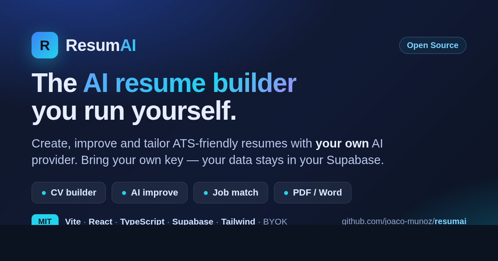
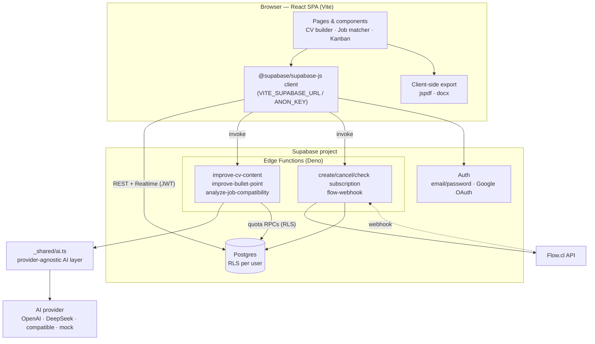

<div align="center">

# ResumAI

**Open-source AI resume builder — create, improve and tailor ATS-friendly resumes using _your own_ AI provider.**

Build multiple resumes, sharpen your professional summary and experience bullets with AI, score your CV against a job description, track applications on a Kanban board, and export to PDF or Word — all self-hostable on Supabase + Vercel, with a **Bring-Your-Own-Key** model so you stay in control of cost and data.

[](./LICENSE)
[](https://github.com/joaco-munoz/resumai/actions/workflows/ci.yml)




</div>

---

## Table of contents

- [Why ResumAI](#why-resumai)
- [Features](#features)
- [Tech stack](#tech-stack)
- [Architecture](#architecture)
- [Quick start](#quick-start)
- [AI provider configuration](#ai-provider-configuration)
- [Self-hosting](#self-hosting)
- [Database](#database)
- [Development commands](#development-commands)
- [Testing](#testing)
- [Security and privacy](#security-and-privacy)
- [Roadmap](#roadmap)
- [Contributing](#contributing)
- [License](#license)
- [Acknowledgements](#acknowledgements)

---

## Why ResumAI

Job seekers increasingly rely on AI to polish resumes, but most tools are closed SaaS products that require you to hand over your resume **and** pay for tokens bundled at a markup. ResumAI takes the opposite stance:

- **For job seekers and developers** who want a capable resume builder they can run themselves.
- **Bring your own key (BYOK).** Point ResumAI at OpenAI, DeepSeek, any OpenAI-compatible endpoint (Groq, Together, a local Ollama / LM Studio), or a **built-in mock provider** for offline use. You pay your provider directly — nothing is marked up.
- **You keep control of your data.** Your CVs live in **your** Supabase project, isolated per-user by Row Level Security. AI keys stay **server-side** and never reach the browser. With the `mock` provider, **no data leaves your machine at all**.
- **It's genuinely open.** MIT-licensed, reproducible from migrations + seed, testable without spending a cent on AI.

> Not sure it does what you need? Try the flow end-to-end with `AI_PROVIDER=mock` — every AI feature works offline with deterministic responses and zero cost.

## Features

### Available now
- 📝 **CV builder** — multi-section editor (personal info, summary, experience, education, skills) with autosave and multiple CVs per account.
- 🤖 **AI improvement** — rewrite your professional summary and experience bullet points for ATS impact, via your chosen provider.
- 🎯 **Job matching** — score a CV against a job description and get strengths, missing keywords and concrete suggestions (returns structured JSON).
- 🗂️ **Application tracking** — Kanban board to move applications through stages.
- 📄 **Export** — download resumes as **PDF** (jspdf) or **Word** (docx), generated client-side.
- 🔐 **Auth & isolation** — Supabase email/password + Google OAuth; per-user data isolation via RLS.
- 🧪 **Mock AI mode** — run and demo every AI feature offline, with no API key and no cost.

### Experimental / partial
- 💳 **Subscriptions (Flow.cl)** — a Pro tier via the Chilean processor Flow. Optional; requires a Flow merchant account.
- 📊 **Admin metrics** — an admin dashboard backed by business-metrics functions.

### Planned / not yet implemented
- 🟡 **MercadoPago** subscriptions — referenced in the UI but the backend function is not implemented yet.
- 🟡 **Self-serve account & data deletion** from the UI (today deletion cascades at the database level; see [Privacy](./docs/privacy.md)).
- 🟡 **Per-user API keys** (see the BYOK note under [AI provider configuration](#ai-provider-configuration)).

See the full [ROADMAP.md](./ROADMAP.md).

## Tech stack

| Layer | Technology | Why |
|-------|-----------|-----|
| Build / dev | **Vite 5** | Fast SPA build & dev server (port `8080`). |
| UI | **React 18 + TypeScript 5** | Component model and type safety. |
| Styling | **Tailwind CSS 3 + shadcn/ui** (Radix) | Accessible, composable components. |
| Routing | **react-router-dom 6** | Client-side routing (public + protected routes). |
| Data fetching | **TanStack Query** + **@supabase/supabase-js** | Server state and Supabase access. |
| Backend | **Supabase** — Postgres, Auth, Edge Functions (Deno) | Database, authentication, and server-side AI/payment logic. |
| AI | **Provider-agnostic layer** (OpenAI / DeepSeek / OpenAI-compatible / mock) | BYOK; keys stay server-side. |
| Docs export | **jspdf**, **docx** + **file-saver** | Client-side PDF/Word generation. |
| Payments (optional) | **Flow.cl** | Pro subscription (Chile). |
| Hosting | **Vercel** (frontend) + **Supabase** (backend) | Simple self-hosting. |

## Architecture

ResumAI is a **client-side SPA**; there is no custom Node server. All privileged logic (AI calls, payments) runs inside **Supabase Edge Functions**, so secrets never reach the browser.



More detail in [ARCHITECTURE.md](./ARCHITECTURE.md).

## Quick start

**Prerequisites:** Node ≥ 18.18 (`.nvmrc` pins 22), npm, and — for a local database — [Docker](https://www.docker.com/) + the [Supabase CLI](https://supabase.com/docs/guides/cli).

```bash
# 1. Clone
git clone https://github.com/joaco-munoz/resumai.git
cd resumai

# 2. Install dependencies
npm install

# 3. Configure environment
cp .env.example .env
# Edit .env and set VITE_SUPABASE_URL and VITE_SUPABASE_ANON_KEY
# (from your Supabase project, or from `supabase start` output below).

# 4a. Start a local database (applies migrations + demo seed)
npm run db:start      # starts local Supabase (Docker)
npm run db:reset      # runs migrations and seeds fictional demo data

# 4b. …or point .env at an existing/remote Supabase project instead.

# 5. Run the app
npm run dev           # http://localhost:8080
```

**Explore with zero cost / no personal data:** set the edge-function secret `AI_PROVIDER=mock` (see [AI provider configuration](#ai-provider-configuration)) and log in with the seeded demo account **`demo@resumai.local` / `demo1234`**. Every AI feature returns deterministic mock output and nothing is sent to any external provider.

Full walkthrough: [docs/installation.md](./docs/installation.md).

## AI provider configuration

The AI layer (`supabase/functions/_shared/ai.ts`) is provider-agnostic. Configure it with **edge-function secrets** (never `VITE_`-prefixed — those are public):

```bash
supabase secrets set AI_PROVIDER=openai AI_API_KEY=sk-...
```

| Provider | `AI_PROVIDER` | Default model | Notes |
|----------|---------------|---------------|-------|
| OpenAI | `openai` | `gpt-4o` | Default. Set `AI_API_KEY` (or legacy `OPENAI_API_KEY`). |
| DeepSeek | `deepseek` | `deepseek-chat` | OpenAI-compatible; often cheaper. |
| OpenAI-compatible | `openai-compatible` | _required_ | Groq, Together, Ollama, LM Studio, self-hosted. Set `AI_BASE_URL` + `AI_MODEL`. |
| Mock | `mock` | — | **Offline, deterministic, zero cost.** No network, no key. Ideal for demos, dev and CI. |

Optional overrides: `AI_MODEL`, `AI_TEMPERATURE`, `AI_MAX_TOKENS`, `AI_TIMEOUT_MS`, `AI_MAX_RETRIES`, `AI_BASE_URL`.

**What is sent to the provider:** for AI improvement, the text you improve (summary or a bullet); for job matching, your CV fields + the job description. With `mock`, **nothing** is sent. Costs are billed by your provider, not ResumAI. Details and how to add a provider: [docs/ai-providers.md](./docs/ai-providers.md).

> **Key handling.** Keys are read from server-side edge-function env only and are never exposed to the browser. Per-user keys (each end-user supplying their own key) are **not** implemented — doing so securely needs encrypted storage; see the note in [docs/ai-providers.md](./docs/ai-providers.md).

## Self-hosting

- **Vercel + Supabase (recommended):** deploy the SPA to Vercel, set `VITE_SUPABASE_URL` / `VITE_SUPABASE_ANON_KEY` as Vercel env vars, push migrations to your Supabase project, and set edge-function secrets. Payments (Flow) are optional.
- **Fully local:** local Supabase via the CLI + `npm run dev`.

**What can cost money:** your AI provider usage; Supabase beyond the free tier; and, only if you enable subscriptions, a Flow.cl merchant account. Everything else — including the `mock` AI provider — is free. Step-by-step: [docs/self-hosting.md](./docs/self-hosting.md).

## Database

Schema is defined by versioned migrations in `supabase/migrations/` and reproduced with a single command:

```bash
npm run db:reset   # applies all migrations + supabase/seed.sql (fictional demo data)
```

14 tables with **Row Level Security on every table** (per-user isolation via `auth.uid()`), plus a demo seed and type generation (`npm run db:types`). See [docs/database.md](./docs/database.md).

## Development commands

| Command | What it does |
|---------|--------------|
| `npm run dev` | Start the Vite dev server on `http://localhost:8080`. |
| `npm run build` | Production build to `dist/`. |
| `npm run preview` | Preview the production build. |
| `npm run lint` | ESLint. |
| `npm run typecheck` | `tsc --noEmit`. |
| `npm run format` / `format:check` | Prettier write / check. |
| `npm run test` | Run unit tests (Vitest). |
| `npm run test:watch` / `test:coverage` | Watch mode / coverage. |
| `npm run db:start` / `db:stop` | Start / stop local Supabase (Docker). |
| `npm run db:reset` | Apply migrations + seed (also re-seeds). |
| `npm run db:migrate` | Apply pending migrations. |
| `npm run db:types` | Regenerate `src/integrations/supabase/types.ts`. |

## Testing

Unit tests run on **Vitest**. The AI layer is tested through an **injected `fetch`** and the **mock provider**, so tests cover the real logic — retries, timeouts, invalid/empty responses, provider errors and config resolution — **without any network calls or API credits**.

```bash
npm run test
```

There is no end-to-end (Playwright) suite yet; it's on the roadmap. See [docs/development.md](./docs/development.md).

## Security and privacy

- CV content is personal data. It lives in **your** Supabase project, isolated per-user by RLS. AI keys are **server-side only**.
- Using a real AI provider sends CV text to that provider; the **`mock`** provider sends nothing.
- Found a vulnerability? Please follow [SECURITY.md](./SECURITY.md) — do **not** open a public issue with exploit details.
- Self-hosters are responsible for their own keys, provider choice and data-protection obligations. We do **not** claim GDPR/CCPA compliance. See [docs/privacy.md](./docs/privacy.md).

## Roadmap

Highlights (full list in [ROADMAP.md](./ROADMAP.md)):

- **In progress:** server-side quota hardening, richer job-match reports.
- **Planned:** self-serve account/data deletion, Playwright e2e, MercadoPago backend, more resume templates.
- **Under consideration:** per-user encrypted API keys, additional AI providers, i18n.

## Contributing

Contributions are welcome! Please read [CONTRIBUTING.md](./CONTRIBUTING.md) and our [Code of Conduct](./CODE_OF_CONDUCT.md). It covers environment setup, coding standards, how to add an AI provider, how to add a migration, and PR requirements (including **never commit secrets or real personal data**).

## License

Released under the **[MIT License](./LICENSE)** — maximum adoption, commercial use allowed, and it keeps the door open for a future hosted offering. See [docs/engineering-decisions.md](./docs/engineering-decisions.md) for the trade-off analysis (MIT vs Apache-2.0 vs AGPLv3). Replace the copyright holder in `LICENSE` with your name if you fork.

## Acknowledgements

Built with [Vite](https://vitejs.dev/), [React](https://react.dev/), [Supabase](https://supabase.com/), [Tailwind CSS](https://tailwindcss.com/), [shadcn/ui](https://ui.shadcn.com/) & [Radix UI](https://www.radix-ui.com/), [TanStack Query](https://tanstack.com/query), [jspdf](https://github.com/parallax/jsPDF) and [docx](https://docx.js.org/). Resume improvements are powered by whichever AI provider you bring.
